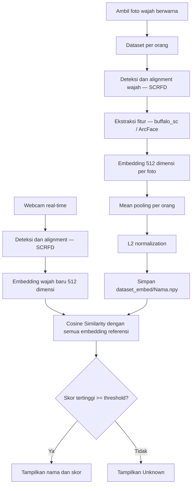

# Face Recognition Real-Time — InsightFace `buffalo_sc`

Sistem pengenalan wajah berbasis **InsightFace `buffalo_sc`** yang berjalan di **CPU**. Identitas ditentukan menggunakan **Cosine Similarity** antara embedding webcam dan embedding referensi tiap orang.

## Alur sistem



## Struktur folder

```text
project/
├── dataset/
│   ├── Rasyid/
│   │   ├── Person-Rasyid-1.jpg
│   │   └── ...
│   ├── Faruq/
│   └── Akbar/
├── dataset_embed/
│   ├── Rasyid.npy
│   ├── Faruq.npy
│   └── Akbar.npy
├── capture.py             # Contoh nama skrip pengambilan foto
├── build_embeddings.py    # Contoh nama skrip ekstraksi dan pooling
└── recognize.py           # Contoh nama skrip webcam + matching
```

> Nama file Python di atas adalah **contoh**; sesuaikan dengan nama skrip proyek. Folder `dataset_embed/` dibuat oleh skrip ekstraksi.

## Instalasi

```bash
pip install opencv-python insightface onnxruntime numpy
```

Unduh model `buffalo_sc` dari [InsightFace Model Zoo](https://github.com/deepinsight/insightface/tree/master/model_zoo), kemudian ekstrak berkas `.onnx` ke:

```text
~/.insightface/models/buffalo_sc/
```

Pada Windows, `~` mengacu ke folder pengguna (`C:\Users\<username>`). Pastikan berkas `.onnx` tidak berada di dalam subfolder `buffalo_sc` tambahan.

Konfigurasi CPU:

```python
from insightface.app import FaceAnalysis

app = FaceAnalysis(name="buffalo_sc", providers=["CPUExecutionProvider"])
app.prepare(ctx_id=-1, det_size=(320, 320))
```

## Tahap 1 — Pengumpulan dataset

1. Buat folder `dataset/NamaOrang/` untuk setiap identitas.
2. Ambil foto dari webcam dalam beragam pose dan pencahayaan.
3. Simpan **foto BGR/berwarna**, bukan grayscale, agar sesuai dengan input model pretrained.
4. Hindari blur, wajah tertutup, serta duplikasi frame yang terlalu mirip.

Jika memakai Haar Cascade untuk *pengambilan* gambar, deteksi boleh memakai grayscale tetapi gambar yang disimpan sebaiknya potongan **frame berwarna**:

```python
cv2.imwrite(output_path, frame[y:y+h, x:x+w])
```

Jumlah 350 foto/orang boleh digunakan, tetapi kualitas dan variasinya lebih penting daripada banyaknya foto. Pastikan foto hanya berisi identitas yang sesuai dengan nama folder.

## Tahap 2 — Pembuatan database embedding

Untuk **setiap orang**, proses semua foto secara independen:

1. Deteksi wajah dan lakukan alignment melalui `app.get(image)`.
2. Ambil `face.normed_embedding` (vektor 512 dimensi).
3. Kumpulkan embedding valid: bentuk `(N, 512)`.
4. Hitung **mean pooling**: rata-rata embedding pada `axis=0`.
5. Lakukan **L2 normalization** pada hasil pooling.
6. Simpan satu vektor `(512,)` ke `dataset_embed/NamaOrang.npy`.

```python
import numpy as np

vectors = np.asarray(embeddings, dtype=np.float32)  # (N, 512)
centroid = vectors.mean(axis=0)                      # (512,)
norm = np.linalg.norm(centroid)
if norm == 0:
    raise ValueError("Centroid tidak valid")
centroid = centroid / norm
np.save("dataset_embed/Rasyid.npy", centroid)
```

**Penting:** kosongkan list `embeddings` setiap kali berganti orang. Jika tak ada wajah terdeteksi dalam satu folder, lewati orang tersebut; jangan menyimpan `NaN`.

## Tahap 3 — Recognition real-time

1. Muat semua file `.npy` ke memori **sekali saat aplikasi dimulai**.
2. Jalankan `app.get(frame)` pada tiap frame webcam untuk mendeteksi wajah.
3. Ambil embedding baru `face.normed_embedding`.
4. Hitung **Cosine Similarity** terhadap seluruh centroid tersimpan.
5. Ambil identitas dengan similarity tertinggi.
6. Jika skor di bawah threshold, tampilkan **Unknown**.

Karena kedua vektor sudah L2-normalized, *dot product* setara dengan Cosine Similarity:

```python
similarities = reference_embeddings @ face.normed_embedding
best_idx = np.argmax(similarities)
best_score = float(similarities[best_idx])
name = names[best_idx] if best_score >= MINIMUM_SIMILARITY else "Unknown"
```

Mulai eksperimen dengan `MINIMUM_SIMILARITY = 0.5`, tetapi **jangan menganggap 0.5 threshold baku**. Kalibrasi terhadap pasangan foto orang yang sama dan berbeda pada data validasi. Perhatikan *false accept* (salah menerima orang) dan *false reject* (menolak orang yang benar).

## Ringkasan parameter

| Komponen | Konfigurasi |
|---|---|
| Detector | SCRFD dalam model pack `buffalo_sc` |
| Face recognition / feature extractor | Model embedding dalam `buffalo_sc` |
| Device | CPU (`CPUExecutionProvider`, `ctx_id=-1`) |
| Detection input size | `320 × 320` |
| Embedding per foto | 512 dimensi |
| Penyimpanan per orang | 1 centroid `(512,)` dalam `.npy` |
| Matching | Cosine Similarity |
| Threshold awal | `0.5` (perlu validasi) |
| Orang tidak dikenal | `Unknown` |

