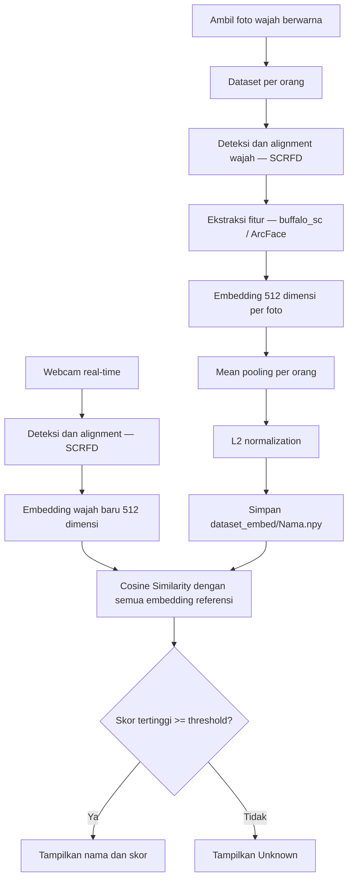

# Face Recognition Real-Time — InsightFace `buffalo_sc`

Sistem pengenalan wajah berbasis **InsightFace `buffalo_sc`** yang berjalan di **CPU**. Identitas ditentukan menggunakan **Cosine Similarity** antara embedding webcam dan embedding referensi tiap orang.

## Alur sistem

## Dependencies

The project uses **Python 3.13.9** with the following dependencies:

| Library | Version | Purpose |
|---|---|---|
| Python | 3.13.9 | Programming language |
| OpenCV | 4.13.0.92 | Image processing and webcam capture |
| NumPy | 2.4.2 | Embedding processing and cosine similarity |
| InsightFace | 2.1 | Face detection and feature extraction |
| ONNX Runtime | 1.31.0 | CPU-based model inference |

